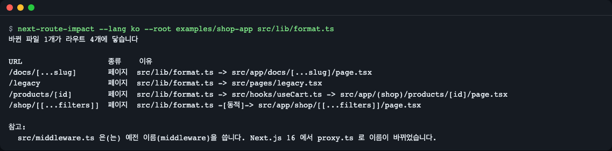
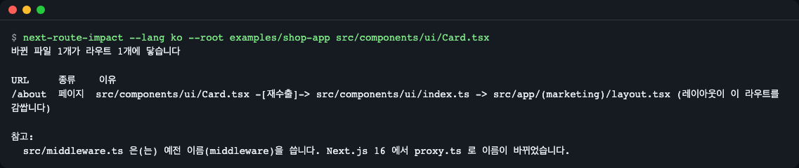
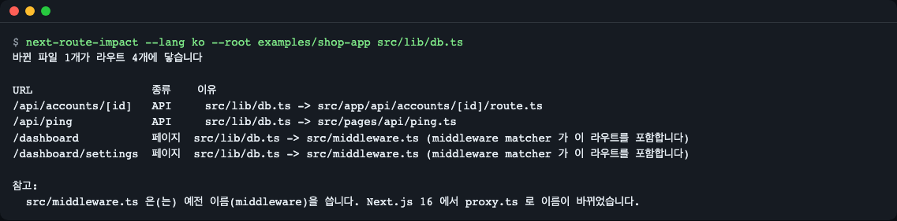
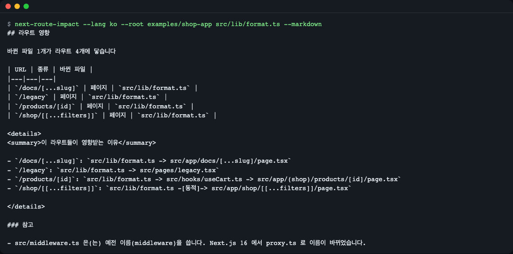
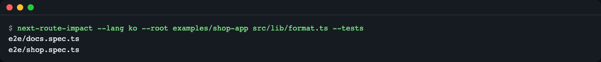
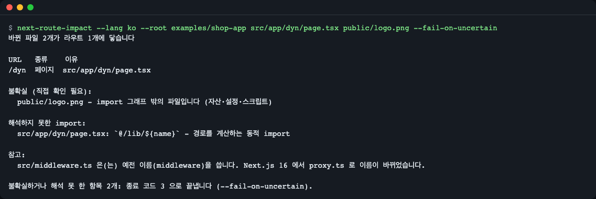
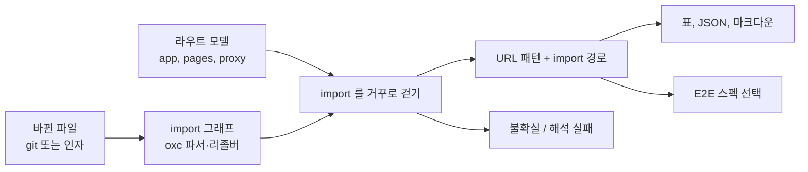

# next-route-impact

[](https://github.com/LeeGyeongPil/next-route-impact/actions/workflows/ci.yml)

[English](README.md) | **한국어**

Next.js 앱에서 바뀐 파일을 알려 주면 그 파일이 닿는 URL 과 API 엔드포인트를, 그렇게 되는 이유(import 경로)와 함께 알려 주는 도구입니다. 돌릴 만한 E2E 스펙 파일도 골라 줍니다. 정적 분석만 하므로 API 키·브라우저·네트워크가 필요 없습니다.


*바뀐 파일 하나(`src/lib/format.ts`)가 라우트 네 개에 닿습니다. 이유 열은 바뀐 파일에서 페이지까지의 import 경로입니다.*

바로가기: [설치](#설치) | [빠르게 시작하기](#빠르게-시작하기) | [CI 에서 쓰기](#ci-에서-쓰기) | [한계](#한계)

## 이런 분께

- Next.js 앱의 PR 을 리뷰하면서 이번 변경이 영향을 줄 수 있는 화면 목록이 필요한 분
- CI 에서 Playwright(또는 다른 E2E)를 돌리는데, 이번 변경에 관련된 스펙만 돌리고 싶은 분
- "이 변경은 `/products/[id]` 와 `/api/accounts/[id]` 에 닿습니다" 같은 PR 댓글을 남기고 싶은 분

## 설치

Node.js `^20.19.0` 또는 `>=22.12.0` 과 git 이 필요합니다.

```bash
# Node.js: https://nodejs.org/ (또는: brew install node)
git clone https://github.com/LeeGyeongPil/next-route-impact.git
cd next-route-impact
npm install
```

`npm install` 은 CLI 도 `dist/` 로 빌드합니다(`prepare` 스크립트가 TypeScript 컴파일러를 실행). 아직 npm 레지스트리에는 올리지 않았으므로 당분간 clone 해서 쓰세요. 최소 리눅스 이미지에서는 `git` 과 Node.js 만 있으면 됩니다.

## 빠르게 시작하기

```bash
npm start
```

레포에 들어 있는 연습용 입력 `examples/shop-app` 에서 `src/lib/format.ts` 가 바뀐 것처럼 분석합니다. 실제 출력입니다.

```
> next-route-impact@0.1.0 start
> node dist/cli.js --lang en --root examples/shop-app src/lib/format.ts

1 changed file(s) reach 4 route(s)

URL                   KIND  REASON
/docs/[...slug]       page  src/lib/format.ts -> src/app/docs/[...slug]/page.tsx
/legacy               page  src/lib/format.ts -> src/pages/legacy.tsx
/products/[id]        page  src/lib/format.ts -> src/hooks/useCart.ts -> src/app/(shop)/products/[id]/page.tsx
/shop/[[...filters]]  page  src/lib/format.ts -[dynamic]-> src/app/shop/[[...filters]]/page.tsx

Notes:
  src/middleware.ts uses the old middleware name; Next.js 16 renamed it to proxy.ts.
```

`npm start` 는 영어로 고정되어 있습니다. 한국어 화면은 `node dist/cli.js --lang ko --root examples/shop-app src/lib/format.ts` 로 봅니다.

읽는 법:

- URL 은 라우트 패턴입니다. `[id]` 는 동적 구간, `[...slug]` 는 catch-all, `[[...filters]]` 는 선택적 catch-all 입니다.
- KIND 는 `page`, `api`(route handler 또는 Pages API), `metadata`(예: `sitemap.ts`) 입니다.
- REASON 은 import 경로입니다. `-[dynamic]->` 는 `next/dynamic`·`import()` 간선, `-[re-export]->` 는 배럴 재내보내기입니다.

**`examples/shop-app` 에 대해:** 실행 가능한 앱이 아니라 연습용 골격입니다. Next.js 와 React 가 설치되어 있지 않고 빌드할 수도 없습니다. 도구가 읽을 현실적인 파일 구조(라우트 그룹, 동적·catch-all 구간, 병렬 슬롯, 가로채기 라우트, route handler, Pages Router, middleware matcher)를 갖추기 위해서만 있습니다.

## 사용법

clone 한 폴더에서 `node dist/cli.js` 로 실행하거나 `npm link` 로 `next-route-impact` 를 PATH 에 올립니다. 내 Next.js 프로젝트에서는 앱 루트(`app/` 또는 `pages/` 가 있는 폴더, 또는 그것을 담은 `src/`)에서 실행하거나 `--root` 를 줍니다.

| 옵션 | 하는 일 | 예 |
|---|---|---|
| `[파일\|폴더 ...]` | 바뀐 파일을 직접 지정(`--root` 기준, 없으면 현재 폴더 기준) | `src/lib/format.ts` |
| `--git` | git 에서 바뀐 파일을 가져옴: `--base` 와의 merge-base, 스테이징, 작업 트리, 미추적 파일 | `next-route-impact --git` |
| `--base <ref>` | `--git` 의 기준 ref (기본: `origin/HEAD`, `origin/main`, `main`, `master`) | `--base origin/develop` |
| `--root <dir>` | Next.js 앱 루트 (기본: 현재 폴더) | `--root apps/web` |
| `--config <path>` | 설정 파일 (기본: `next-route-impact.config.json` 또는 `package.json` 의 `"nextRouteImpact"`) | `--config ci/impact.json` |
| `--json` | 기계가 읽는 출력 (`schemaVersion: 1`, 두 언어 모두 키는 영어) | `--json` |
| `--markdown` | 표와 접히는 "이유" 목록, PR 댓글용 | `--markdown` |
| `--tests` | 돌릴 테스트 파일 출력 (설정의 `tests` 필요) | `--tests` |
| `--include-types` | `import type` 간선도 따라감 (기본은 제외) | `--include-types` |
| `--fail-on-uncertain` | 불확실하거나 해석 못 한 항목이 있으면 종료 코드 3 | `--fail-on-uncertain` |
| `--lang <en\|ko>` | 출력 언어 | `--lang ko` |
| `-h`, `-v` | 도움말, 버전 | |

종료 코드는 [출력](#출력)에 있습니다. 존재하지 않는 파일 인자는 "삭제됨"이 아니라 사용법 오류(종료 코드 2)입니다. 오타가 "영향 없음"처럼 보이는 것을 막기 위해서입니다. 삭제는 `--git` 으로만 보고됩니다.

### 시나리오 1: 배럴 파일, 레이아웃, 미들웨어

시나리오의 명령은 clone 한 폴더에서 `node dist/cli.js` 로 실행합니다(`npm link` 후에는 `next-route-impact`). 이 시나리오: `node dist/cli.js --root examples/shop-app src/components/ui/Card.tsx`, `node dist/cli.js --root examples/shop-app src/lib/db.ts`.

`Card.tsx` 를 바꾸면 배럴 `ui/index.ts` 에서 `Card` 를 가져오는 페이지만 영향을 받습니다. 도구가 가져온 이름을 따라가므로 배럴을 쓰는 모든 페이지가 아니라 `/about`(레이아웃 경유)만 나옵니다.


*심볼 정밀화: `Card.tsx` 변경은 `/about` 에만 닿습니다. 라이브러리 API 에서 `symbolPrecision: false` 를 주면 `/` 도 나옵니다.*

`src/lib/db.ts` 같은 서버 전용 모듈은 API 핸들러에는 직접, 페이지에는 middleware matcher 를 통해 닿습니다.


*직접 import 가 래퍼보다 우선합니다. `/api/ping` 은 자기 파일이 이유이고, `/dashboard` 는 middleware matcher 가 포함해서 나옵니다.*

### 시나리오 2: PR 댓글

```bash
node dist/cli.js --root examples/shop-app src/lib/format.ts --markdown
```

`--markdown` 은 표와 import 경로가 담긴 `<details>` 블록을 출력합니다. 잡 요약에 덧붙이거나 직접 만든 워크플로 단계에서 댓글로 올리면 됩니다.


*같은 분석의 마크다운 형태입니다.*

## CI 에서 쓰기

PR 을 라우트 목록과 스펙 목록으로 바꿔 줍니다. 완성된 워크플로: [docs/examples/pr-impact.yml](docs/examples/pr-impact.yml).

### 시나리오 3: E2E 스펙 고르기

`next-route-impact.config.json` 에 URL 글롭 → 테스트 글롭 매핑을 적습니다.

```json
{
  "tests": {
    "/products/**": ["e2e/shop.spec.ts"],
    "/docs/**": ["e2e/docs.spec.ts"],
    "/dashboard/**": ["e2e/dashboard/*.spec.ts"]
  }
}
```

```bash
node dist/cli.js --root examples/shop-app src/lib/format.ts --tests
```


*실제로 존재하는 스펙 파일만 나옵니다. `/legacy` 는 영향을 받지만 매핑이 없어서, 조용히 건너뛰지 않고 `--json` 출력의 `unmappedRoutes` 에 담깁니다.*

`--tests --json` 의 결과는 `tests` 아래에 `runAll`, `runAllReasons`, `files`, `unmappedRoutes` 로 들어 있습니다. `next.config.ts`·`package.json`·락 파일·`tsconfig*.json`·`.env*` 가 바뀌면 `runAll` 이 켜집니다(아래 `runAllOn`). 바뀐 스펙 파일 자체도 포함됩니다.

완성된 워크플로는 [docs/examples/pr-impact.yml](docs/examples/pr-impact.yml) 에 있습니다. 문서용 예시이며 이 레포의 CI 는 실행하지 않습니다. 패키지가 아직 npm 에 없으므로 `npx next-route-impact` 를 부르기 전에 `npm install --no-save github:LeeGyeongPil/next-route-impact` 로 GitHub 에서 설치합니다. `--git` 이 merge-base 를 찾도록 `fetch-depth: 0` 을 쓰세요.

### 시나리오 4: "분석 못 함"은 "영향 없음"이 아닙니다

정적으로 따라갈 수 없는 변경은 숨기지 않고 따로 보여 줍니다.

```bash
node dist/cli.js --root examples/shop-app src/app/dyn/page.tsx public/logo.png --fail-on-uncertain
```


*계산된 `import()` 경로는 해석 실패이고, `public/logo.png` 는 import 그래프 밖입니다. `--fail-on-uncertain` 이면 종료 코드가 3 입니다.*

- `uncertain`: import 그래프에 없는 변경 파일(자산·스크립트), 삭제된 비진입 파일, 정적으로 읽을 수 없는 middleware matcher.
- `unresolved`: 도구가 따라가지 못한 import(계산된 경로, 해석되지 않는 별칭). 변경된 파일과 거기서 닿은 파일 안의 import 만 나옵니다.
- `parseErrors`: 파싱하지 못한 파일. 나머지 분석은 계속됩니다.

## 이해하는 규칙

도구는 Next.js 파일 규칙을 읽으므로 "이 URL 이 왜 나왔는지(또는 안 나왔는지)"를 답할 수 있습니다. 아래 예시 경로는 `examples/shop-app` 에 실제로 있는 파일입니다.

| 규칙 | 도구가 하는 일 | `examples/shop-app` 의 예 |
|---|---|---|
| `page.tsx`(App Router), `pages/**` | 진입 파일. URL 패턴이 됨 | `src/app/docs/[...slug]/page.tsx` 는 `/docs/[...slug]` |
| 라우트 그룹 `(name)` | 폴더 이름이 URL 에서 사라짐 | `src/app/(shop)/products/[id]/page.tsx` 는 `/products/[id]` |
| `[id]`, `[...slug]`, `[[...slug]]` | 동적·catch-all·선택적 catch-all 구간은 패턴에 남음 | `/shop/[[...filters]]` |
| 병렬 슬롯 `@name` | 슬롯 이름은 URL 에 없고, 슬롯은 부모 URL 에 속함 | `src/app/dashboard/@analytics/page.tsx` 는 `/dashboard` 의 일부 |
| 가로채기 `(.)`, `(..)`, `(..)(..)`, `(...)` | 라우트 구간 기준으로 계산하고 `intercept` 로 표시 | `src/app/feed/(.)photo/[id]/page.tsx` 는 `/feed/photo/[id]` |
| 비공개 폴더 `_name` | 라우트가 아님. 안의 파일은 일반 모듈 | `src/app/_private/helper.ts` |
| `route.ts`(App Router), `pages/api/**` | `api` 종류의 진입 파일 | `/api/accounts/[id]`, `/api/ping` |
| 메타데이터 파일(`sitemap`, `robots`, `manifest`, `icon`, `opengraph-image` 등) | `metadata` 종류의 진입 파일 | 예제 앱에는 없음 |
| `layout`, `template`, `loading`, `error`, `not-found` | 바뀌면 그 폴더 아래 모든 page 에 닿음. route handler(`route.ts`)는 감싸지 않음 | `dashboard/layout.tsx` 는 `/dashboard`, `/dashboard/settings` 에 닿음 |
| `global-error` | 바뀌면 모든 App Router page 에 닿음 | 예제 앱에는 없음 |
| `src/pages/_app.tsx`, `_document` | 바뀌면 모든 Pages Router page 에 닿음(App Router·API 라우트 제외) | `_app.tsx` 는 `/legacy` 에 닿음 |
| `proxy.ts`(Next.js 16) 또는 `middleware.ts` | 파일이나 그것이 import 하는 모듈이 바뀌면 `config.matcher` 가 포함하는 라우트에 닿음 | `src/middleware.ts`, matcher `['/dashboard/:path*', '/api/:path*']` |

`matcher` 읽는 법: 문자열, 배열, `source` 를 가진 객체, `:path*`·`:path+`·`:param`, 괄호 정규식(기본 템플릿 `/((?!api|_next/static|_next/image|favicon.ico).*)` 포함). `config` 가 없으면 모든 라우트입니다. 리터럴이 아니거나 도구가 변환하지 못하는 문법이면 모든 라우트 + `uncertain` 항목(`matcher-not-static` 또는 `matcher-unsupported`)을 내므로, 결과는 부족하기보다 많이 나오는 쪽입니다. 동적 URL 은 표본 값으로 대조합니다.

대부분의 의문은 두 규칙으로 풀립니다.

- 직접 import 가 래퍼보다 우선합니다. import 경로로 닿은 라우트는 그 경로가 이유이고, layout·`_app`·middleware 확산은 그 뒤에 적용됩니다. 그래서 `/api/ping` 의 이유는 middleware 가 아니라 `src/pages/api/ping.ts` 입니다.
- 한 URL 에 진입 파일이 여럿이면 JSON 의 `file` 은 주 page, 가로채기 page, 슬롯 page 순으로 고릅니다. `/dashboard` 는 `src/app/dashboard/page.tsx` 로 나옵니다.

타입 import(`import type`)는 `--include-types` 를 주지 않으면 무시합니다. 배럴 파일(재내보내는 `index.ts`)은 가져온 이름 단위로 따라가므로, 바뀐 export 를 가져오는 쪽만 나옵니다.

## Node/TypeScript API

```js
import { analyze, selectTests, loadConfig } from 'next-route-impact';

const root = 'examples/shop-app';
const report = await analyze({ root, changed: [{ path: 'src/lib/format.ts', status: 'modified' }] });
console.log(report.routes.map((r) => r.url));
// [
//   '/docs/[...slug]',
//   '/legacy',
//   '/products/[id]',
//   '/shop/[[...filters]]'
// ]

console.log(selectTests(report, loadConfig(root), root).files);
// [ 'e2e/docs.spec.ts', 'e2e/shop.spec.ts' ]
```

위 출력은 실제 결과입니다(빌드된 `dist/` 를 경로로 import 해서 실행. 패키지가 아직 레지스트리에 없기 때문입니다). 내보내는 것: `analyze`, `analyzeSync`, `selectTests`, `loadConfig`, `parseConfig`, `defaultConfig`, `gitChangedFiles`, `renderJson`, `renderMarkdown`, `renderTable`, `resolveLang`, `tr`, `ImpactError` 와 결과 타입. `AnalyzeOptions` 는 `includeTypes`, `symbolPrecision`(기본 `true`), 일부 `config` 도 받습니다. 각 라우트는 `kind`, `url`, `router`, `file`, `intercept`, `via`, `edges`, `expandedBy`, `changed` 를 가집니다.

## 설정

`next-route-impact.config.json`(또는 `package.json` 의 `"nextRouteImpact"`), 모든 필드는 선택입니다.

| 필드 | 뜻 | 기본값 |
|---|---|---|
| `tests` | URL 글롭 → 테스트 글롭, `--tests` 가 사용 | 없음 |
| `runAllOn` | 바뀐 파일이 이 글롭에 맞으면 `runAll` | `next.config.*`, `package.json`, 락 파일, `tsconfig*.json`, `.env*`, `tailwind.config.*`, `postcss.config.*` |
| `ignore` | 바뀐 파일이 이 글롭에 맞으면 무시 | `**/*.md`, `.github/**` |
| `tsconfig` | 앱 루트 기준 tsconfig 경로 | 자동 탐지 |

## 출력

기본 출력은 표(URL, KIND, REASON)입니다. `--markdown` 은 표와 import 경로가 담긴 `<details>` 블록을 냅니다. `--json` 은 아래 객체를 냅니다(`schemaVersion: 1`, 키와 enum 값은 두 언어 모두 영어).

| 필드 | 뜻 |
|---|---|
| `schemaVersion` | 항상 `1` |
| `changed` | 입력 파일: `{ path, status }`, `status` 는 `modified`·`added`·`deleted`·`renamed`. 이름 변경에는 `oldPath` 도 있음 |
| `routes` | 영향받는 라우트: `kind`(`page`·`api`·`metadata`), `url`, `router`(`app`·`pages`), `file`(라우트 자신의 진입 파일), `intercept`, `via`(import 경로, 처음이 변경 파일·마지막이 진입 파일), `edges`(구간마다 `static`·`reexport`·`dynamic`·`type`), `expandedBy`(`null` 또는 변경을 퍼뜨린 layout·`_app`·middleware), `changed`(원인이 된 변경 파일) |
| `removedRoutes` | 진입 파일이 삭제되었거나 이름이 바뀌어 사라진 라우트(`kind`, `url`, `router`, `file`). 옛 URL 은 더 이상 없음 |
| `uncertain` | `{ file, reason }`, reason 은 `outside-graph`·`deleted`·`matcher-not-static`·`matcher-unsupported` |
| `unresolved` | 따라가지 못한 import: `{ file, specifier, reason }`, reason 은 `non-literal-dynamic-import`·`not-found` |
| `parseErrors` | 파싱 실패 파일: `{ file, count, message }` |
| `notes` | `{ code, message }`. 지금은 `middleware-renamed` 만 있음. `message` 는 선택한 언어 |
| `tests` | `--tests` 일 때만: `runAll`, `runAllReasons`, `files`, `unmappedRoutes` |

`--git` 은 `git diff --name-status -M` 으로 base ref 와의 merge-base 이후 변경과 미추적 파일을 가져옵니다. 수정·추가 파일은 그대로 분석합니다. 이름이 바뀐 파일은 새 경로로 분석하고, 옛 경로가 page 나 route 였다면 `removedRoutes` 에 올립니다. 삭제된 page·route 는 `removedRoutes` 로, 그 밖의 삭제 파일은 옛 importer 를 따라갈 수 없으므로(0.1.0 미지원) 이유 `deleted` 의 `uncertain` 으로 나옵니다.

종료 코드:

| 코드 | 뜻 |
|---|---|
| `0` | 분석 완료(라우트가 나왔는지와 무관) |
| `1` | 실행 오류: `app/`·`pages/` 폴더 없음, git 실패, 없는 base ref, 앱 안의 읽을 수 없는 폴더(`폴더 "..." 을(를) 읽을 수 없습니다`) |
| `2` | 사용법 오류: 알 수 없는 옵션, 값 빠짐, `--json` 과 `--markdown` 동시, 입력 없음, 존재하지 않는 파일 인자, `tests` 매핑 없는 `--tests` |
| `3` | 불확실·해석 실패 항목이 있고 `--fail-on-uncertain` 을 줌 |

## 언어

출력(도움말·표 머리글·마크다운·안내·오류)은 영어와 한국어를 지원합니다. 우선순위: `--lang en|ko`, 환경변수 `ROUTE_IMPACT_LANG`, `LC_ALL`, `LC_MESSAGES`, `LANG`. `ko` 로 시작하면 한국어, 그 밖은 영어입니다.

```bash
node dist/cli.js --lang ko --root examples/shop-app src/lib/format.ts
ROUTE_IMPACT_LANG=ko node dist/cli.js --root examples/shop-app src/lib/format.ts
```

JSON 의 키와 enum 값은 두 언어 모두 영어입니다. `npm start` 는 영어로 고정되어 있습니다.

## 동작 원리



1. 바뀐 파일은 git(`--git`) 이나 인자에서 가져옵니다.
2. import 그래프는 [oxc-parser](https://github.com/oxc-project/oxc) 와 [oxc-resolver](https://github.com/oxc-project/oxc-resolver) 로 만듭니다. tsconfig `paths`, 배럴, `import()`, `next/dynamic` 을 포함합니다.
3. 진입 파일(`page`, `route`, `layout`, `_app`, `proxy`/`middleware`)을 Next.js 파일 규칙에 따라 URL 패턴으로 바꿉니다.
4. 바뀐 파일에서 진입 파일에 닿을 때까지 그래프를 거꾸로 걷습니다. 지나온 경로가 곧 이유입니다.
5. 바뀐 `layout`·`_app`·middleware/proxy matcher 는 직접 닿은 라우트를 찾은 뒤에 그것이 감싸는 라우트로 확산됩니다.
6. 따라갈 수 없는 것은 따로 보고합니다.

## 언제 쓰나 (그리고 대안)

- 잘 맞는 상황: 브라우저를 돌리지 않고 "이 PR 이 이 URL·API 라우트와 이 스펙에 닿는다"를 알고 싶은 Next.js 앱.
- 다른 도구가 나을 수 있는 상황:
  - 모노레포의 패키지 단위 affected 빌드: [Nx](https://github.com/nrwl/nx), [Turborepo](https://github.com/vercel/turborepo)
  - 바뀌었거나 바뀐 파일에 의존하는 테스트 파일만 실행: Playwright 의 [`--only-changed`](https://playwright.dev/docs/test-cli)
  - 영향받는 페이지 파일 목록: [next-affected](https://github.com/bubablue/next-affected)
  - 컴포넌트 하나의 라우트 영향: [component-to-route](https://www.npmjs.com/package/component-to-route)
  - 브라우저 기반 검사를 곁들인 비슷한 라우트 영향 도구: [djig/route-impact](https://github.com/djig/route-impact)
  - JavaScript 프로젝트의 일반 의존성 규칙·그래프: [dependency-cruiser](https://github.com/sverweij/dependency-cruiser)

각 프로젝트가 지금 무엇을 지원하는지는 해당 문서를 확인하세요.

## 한계

- import 가 아닌 결합은 보이지 않습니다: `fetch('/api/...')` 의 URL 문자열, `rewrites`, 환경변수, CSS-in-JS 문자열, `public/` 아래 자산. 바뀐 자산은 `uncertain` 으로, 설정 수준 파일은 `runAll` 로 다룹니다.
- 계산된 `import()` 경로는 간선을 숨깁니다. 변경·도달한 파일 안의 것만 보고하므로, 앱 다른 곳의 동적 import 가 내 변경으로 가는 간선을 숨기고 있을 수 있습니다.
- 0.1.0 에서 다루지 않는 것: 모노레포 워크스페이스 패키지, `pageExtensions`, 삭제·이름 변경된 파일의 옛 importer 추적, stdin 입력, 바로 쓰는 GitHub Action, `--mermaid` 출력.
- 선언한 최소 버전은 Node.js 20 이지만 이 버전을 만든 환경에서는 실행해 보지 못했습니다. CI 매트릭스가 Node 20·22 를 확인합니다.
- Next.js 라우팅 규칙만 이해합니다(App Router, Pages Router, `proxy.ts` 와 구 `middleware.ts`).

## 자주 겪는 문제

| 증상 | 원인 | 해결 |
|---|---|---|
| `No app/ or pages/ directory found in "..."` (한국어 화면에서는 같은 뜻의 한국어 문장) | `--root` 가 Next.js 앱을 가리키지 않음 | `app/` 또는 `pages/`(또는 그것을 담은 `src/`)가 있는 폴더를 `--root` 로 지정 |
| `The base ref "..." does not exist` | 기준 브랜치를 가져오지 않음 | `git fetch` 하거나 `--base` 로 다른 ref 지정 |
| `No common ancestor between "..." and HEAD` | CI 의 얕은 clone | `actions/checkout` 에 `fetch-depth: 0` |
| `Choose one output format` (종료 코드 2) | `--json` 과 `--markdown` 을 같이 줌 | 하나만 사용 |
| `The file "..." does not exist` (종료 코드 2) | 파일 인자 오타, 또는 삭제된 파일 | 경로를 고치세요. 삭제는 `--git` 으로 확인 |
| `Cannot read the folder ...` (종료 코드 1) | 앱 안의 폴더를 읽을 수 없음(권한) | 폴더 권한을 고친 뒤 다시 실행 |
| `Notes: ... uses the old middleware name` | 앱에 아직 `middleware.ts` 가 있음 | 안내일 뿐입니다. Next.js 16 에서 `proxy.ts` 로 이름이 바뀌었고 둘 다 읽습니다 |
| 종료 코드 3 | `--fail-on-uncertain` 인데 불확실 항목이 있음 | "불확실" 목록의 파일을 직접 확인 |

(오류 문장은 `--lang en` 기준입니다. `--lang ko` 에서는 같은 내용이 한국어로 나옵니다.)

## 개발·기여

```bash
npm install
npm test
```

`npm test` 는 CLI 를 빌드하고 `node:test` 로 120개 테스트를 돌립니다. 버그·제안은 이슈로 남겨 주세요. 변경 기록은 [CHANGELOG.md](CHANGELOG.md).

## 라이선스

MIT. 런타임 의존성: oxc-parser, oxc-resolver (둘 다 MIT).
