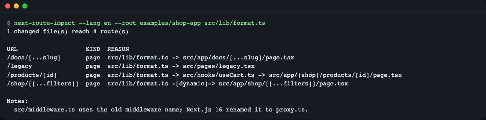
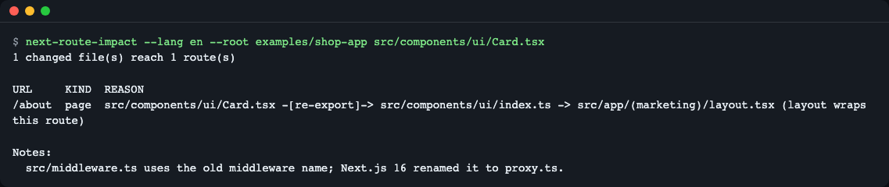
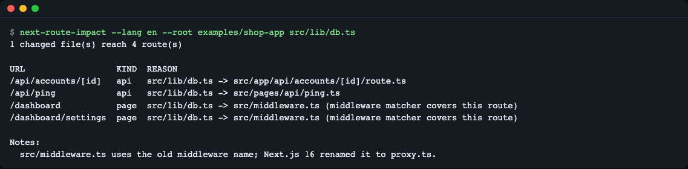
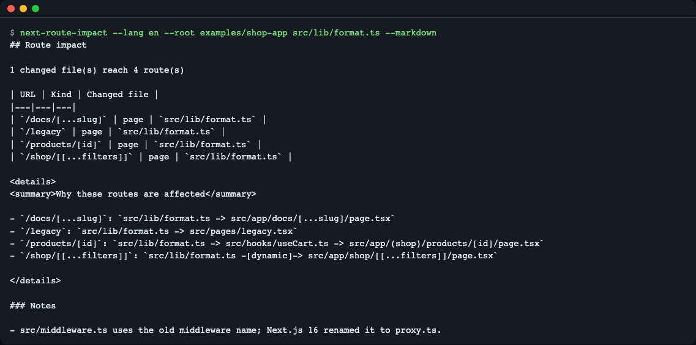
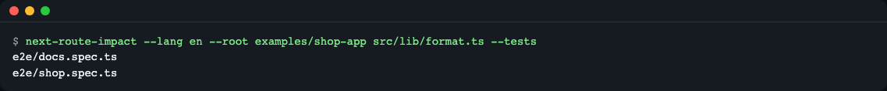
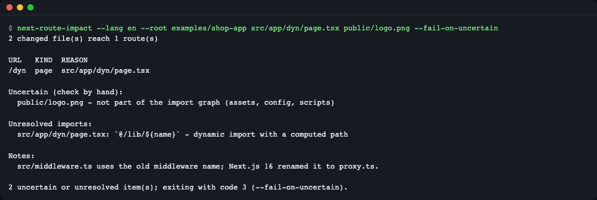
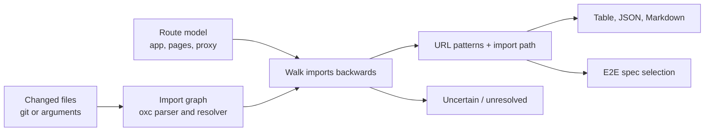

# next-route-impact

[](https://github.com/LeeGyeongPil/next-route-impact/actions/workflows/ci.yml)

**English** | [한국어](README.ko.md)

Tell it which files changed in a Next.js app and it tells you which URLs and API endpoints those files reach, with the import path that explains each hit. It can also pick the end-to-end spec files worth running. It is static analysis only: no API key, no browser, no network.


*One changed file (`src/lib/format.ts`) reaches four routes. The REASON column is the import chain from the changed file to the page.*

Jump to: [Install](#install) | [Quick start](#quick-start) | [Use in CI](#use-in-ci) | [Limitations](#limitations)

## Who it is for

- You review pull requests on a Next.js app and want the list of screens a change can affect.
- You run Playwright (or any E2E suite) in CI and want to run only the specs that matter for this change.
- You want a pull request comment such as "this change touches `/products/[id]` and `/api/accounts/[id]`".

## Install

Requires Node.js `^20.19.0` or `>=22.12.0` and git.

```bash
# Node.js: https://nodejs.org/ (or: brew install node)
git clone https://github.com/LeeGyeongPil/next-route-impact.git
cd next-route-impact
npm install
```

`npm install` also builds the CLI into `dist/` (the `prepare` script runs the TypeScript compiler). The package is not published to the npm registry yet, so use the clone for now. On a minimal Linux image you need `git` and a Node.js toolchain; nothing else.

## Quick start

```bash
npm start
```

This analyzes the bundled practice input in `examples/shop-app` as if `src/lib/format.ts` had changed. Real output:

```
> next-route-impact@0.1.0 start
> node dist/cli.js --lang en --root examples/shop-app src/lib/format.ts

1 changed file(s) reach 4 route(s)

URL                   KIND  REASON
/docs/[...slug]       page  src/lib/format.ts -> src/app/docs/[...slug]/page.tsx
/legacy               page  src/lib/format.ts -> src/pages/legacy.tsx
/products/[id]        page  src/lib/format.ts -> src/hooks/useCart.ts -> src/app/(shop)/products/[id]/page.tsx
/shop/[[...filters]]  page  src/lib/format.ts -[dynamic]-> src/app/shop/[[...filters]]/page.tsx

Notes:
  src/middleware.ts uses the old middleware name; Next.js 16 renamed it to proxy.ts.
```

How to read it:

- URL is the route pattern. `[id]` is a dynamic segment, `[...slug]` a catch-all, `[[...filters]]` an optional catch-all.
- KIND is `page`, `api` (route handler or Pages API) or `metadata` (for example `sitemap.ts`).
- REASON is the import chain. `-[dynamic]->` marks a `next/dynamic` or `import()` edge, `-[re-export]->` a barrel re-export.

**About `examples/shop-app`:** it is a practice skeleton, not a runnable app. Next.js and React are not installed there and it cannot be built. It only exists so the tool has realistic file layouts to read (route groups, dynamic and catch-all segments, a parallel slot, an intercepting route, route handlers, the Pages Router and a middleware matcher).

## Usage

Run `node dist/cli.js` from the clone, or put `next-route-impact` on your PATH with `npm link`. Inside your own Next.js project, run it from the app root (the folder with `app/` or `pages/`, or `src/` containing them), or pass `--root`.

| Option | What it does | Example |
|---|---|---|
| `[file\|dir ...]` | Analyze these changed files (relative to `--root`, then the current folder) | `src/lib/format.ts` |
| `--git` | Take changed files from git: merge-base with `--base`, staged, unstaged, untracked | `next-route-impact --git` |
| `--base <ref>` | Base ref for `--git` (default: `origin/HEAD`, `origin/main`, `main`, `master`) | `--base origin/develop` |
| `--root <dir>` | Next.js app root (default: current folder) | `--root apps/web` |
| `--config <path>` | Config file (default: `next-route-impact.config.json` or `"nextRouteImpact"` in `package.json`) | `--config ci/impact.json` |
| `--json` | Machine-readable output (`schemaVersion: 1`, English keys in both languages) | `--json` |
| `--markdown` | Table plus a collapsible "why" list, for pull request comments | `--markdown` |
| `--tests` | Print the test files to run (needs `tests` in the config) | `--tests` |
| `--include-types` | Also follow `import type` edges (ignored by default) | `--include-types` |
| `--fail-on-uncertain` | Exit with code 3 if anything is uncertain or unresolved | `--fail-on-uncertain` |
| `--lang <en\|ko>` | Output language | `--lang ko` |
| `-h`, `-v` | Help, version | |

Exit codes are listed under [Output](#output). A file argument that does not exist is a usage error (exit 2), not "deleted": a typo would otherwise look like "no impact". Deletions are reported only through `--git`.

### Scenario 1: a barrel file, a layout and a middleware

Commands in the scenarios run from the clone (`node dist/cli.js`; use `next-route-impact` after `npm link`). Here: `node dist/cli.js --root examples/shop-app src/components/ui/Card.tsx` and `node dist/cli.js --root examples/shop-app src/lib/db.ts`.

Changing `Card.tsx` only matters to pages that import `Card` from the barrel `ui/index.ts`. The tool follows the imported names, so only `/about` is listed (through its layout), not every page that uses the barrel.


*Symbol precision: a change to `Card.tsx` reaches `/about` only. Via the library API, `symbolPrecision: false` also lists `/`.*

A server-only module such as `src/lib/db.ts` reaches API handlers directly, and reaches pages through the middleware matcher:


*Direct imports win over wrappers: `/api/ping` is explained by its own file, while `/dashboard` is reached because the middleware matcher covers it.*

### Scenario 2: a pull request comment

```bash
node dist/cli.js --root examples/shop-app src/lib/format.ts --markdown
```

`--markdown` prints a table and a `<details>` block with the import chains. Append it to the job summary or post it as a comment from your own workflow step.


*The Markdown form of the same analysis.*

## Use in CI

The tool turns a pull request into a route list and a spec list. Complete workflow: [docs/examples/pr-impact.yml](docs/examples/pr-impact.yml).

### Scenario 3: pick the E2E specs

Map URL globs to test globs in `next-route-impact.config.json`:

```json
{
  "tests": {
    "/products/**": ["e2e/shop.spec.ts"],
    "/docs/**": ["e2e/docs.spec.ts"],
    "/dashboard/**": ["e2e/dashboard/*.spec.ts"]
  }
}
```

```bash
node dist/cli.js --root examples/shop-app src/lib/format.ts --tests
```


*Only spec files that exist are listed. `/legacy` is reached but has no mapping; it is listed under `unmappedRoutes` in the `--json` output instead of being skipped silently.*

With `--tests --json` the result is under `tests`: `runAll`, `runAllReasons`, `files` and `unmappedRoutes`. A changed `next.config.ts`, `package.json`, lockfile, `tsconfig*.json` or `.env*` sets `runAll` (see `runAllOn` below). Changed spec files themselves are included.

A complete workflow is in [docs/examples/pr-impact.yml](docs/examples/pr-impact.yml). It is documentation only; this repository's CI does not run it. Because the package is not on npm yet, it installs the tool from GitHub with `npm install --no-save github:LeeGyeongPil/next-route-impact` before calling `npx next-route-impact`. Use `fetch-depth: 0` so `--git` can find the merge-base.

### Scenario 4: "not analysable" is not "no impact"

Some changes cannot be traced statically. They are listed separately instead of being hidden:

```bash
node dist/cli.js --root examples/shop-app src/app/dyn/page.tsx public/logo.png --fail-on-uncertain
```


*A computed `import()` path is unresolved, and `public/logo.png` is outside the import graph. With `--fail-on-uncertain` the exit code is 3.*

- `uncertain`: a changed file that is not part of the import graph (assets, scripts), a deleted non-entry file, or a middleware matcher that cannot be read statically.
- `unresolved`: an import the tool could not follow (computed path, alias that does not resolve). Only imports in changed files, or in files reached from them, are listed.
- `parseErrors`: files that could not be parsed. The rest of the analysis continues.

## What it understands

The tool reads the Next.js file conventions, so it can answer "why is this URL listed, or not?". The example app paths below are real files in `examples/shop-app`.

| Convention | What the tool does | Example in `examples/shop-app` |
|---|---|---|
| `page.tsx` (App Router), `pages/**` | Entry file; becomes a URL pattern | `src/app/docs/[...slug]/page.tsx` is `/docs/[...slug]` |
| Route group `(name)` | The folder name disappears from the URL | `src/app/(shop)/products/[id]/page.tsx` is `/products/[id]` |
| `[id]`, `[...slug]`, `[[...slug]]` | Dynamic, catch-all and optional catch-all segments are kept in the pattern | `/shop/[[...filters]]` |
| Parallel slot `@name` | The slot name is not part of the URL; the slot belongs to its parent URL | `src/app/dashboard/@analytics/page.tsx` is part of `/dashboard` |
| Intercepting `(.)`, `(..)`, `(..)(..)`, `(...)` | Counted by route segments; the result is marked `intercept` | `src/app/feed/(.)photo/[id]/page.tsx` is `/feed/photo/[id]` |
| Private folder `_name` | Not a route; files inside are ordinary modules | `src/app/_private/helper.ts` |
| `route.ts` (App Router), `pages/api/**` | Entry file of kind `api` | `/api/accounts/[id]`, `/api/ping` |
| Metadata files (`sitemap`, `robots`, `manifest`, `icon`, `opengraph-image`, ...) | Entry file of kind `metadata` | none in the example app |
| `layout`, `template`, `loading`, `error`, `not-found` | A change reaches every page below that folder. Route handlers (`route.ts`) are not wrapped | `dashboard/layout.tsx` reaches `/dashboard` and `/dashboard/settings` |
| `global-error` | A change reaches every App Router page | none in the example app |
| `src/pages/_app.tsx`, `_document` | A change reaches every Pages Router page (not App Router, not API routes) | `_app.tsx` reaches `/legacy` |
| `proxy.ts` (Next.js 16) or `middleware.ts` | A change to the file or to a module it imports reaches the routes its `config.matcher` covers | `src/middleware.ts`, matcher `['/dashboard/:path*', '/api/:path*']` |

How the `matcher` is read: a string, an array, or objects with `source`; `:path*`, `:path+`, `:param` and parenthesised regular expressions, including the default template `/((?!api|_next/static|_next/image|favicon.ico).*)`. No `config` means every route. A matcher that is not a literal, or that uses syntax the tool cannot convert, means every route plus an `uncertain` entry (`matcher-not-static` or `matcher-unsupported`), so the result errs on the side of listing too much. Dynamic URLs are matched with sample values.

Two rules explain most surprises:

- Direct imports win over wrappers. A route reached by an import chain is explained by that chain; layout, `_app` and middleware expansion is applied afterwards. `/api/ping` is therefore explained by `src/pages/api/ping.ts`, not by the middleware.
- When one URL has several entry files, the JSON `file` field prefers the main page, then an intercepting page, then a slot page. `/dashboard` reports `src/app/dashboard/page.tsx`.

Imports of types (`import type`) are ignored unless you pass `--include-types`. Barrel files (`index.ts` that re-export) are followed by imported name, so only importers of the changed export are listed.

## Node/TypeScript API

```js
import { analyze, selectTests, loadConfig } from 'next-route-impact';

const root = 'examples/shop-app';
const report = await analyze({ root, changed: [{ path: 'src/lib/format.ts', status: 'modified' }] });
console.log(report.routes.map((r) => r.url));
// [
//   '/docs/[...slug]',
//   '/legacy',
//   '/products/[id]',
//   '/shop/[[...filters]]'
// ]

console.log(selectTests(report, loadConfig(root), root).files);
// [ 'e2e/docs.spec.ts', 'e2e/shop.spec.ts' ]
```

Output above is real (run against the built `dist/`, importing by path because the package is not on the registry yet). Exports: `analyze`, `analyzeSync`, `selectTests`, `loadConfig`, `parseConfig`, `defaultConfig`, `gitChangedFiles`, `renderJson`, `renderMarkdown`, `renderTable`, `resolveLang`, `tr`, `ImpactError` and the result types. `AnalyzeOptions` also takes `includeTypes`, `symbolPrecision` (default `true`) and a partial `config`. Each route has `kind`, `url`, `router`, `file`, `intercept`, `via`, `edges`, `expandedBy` and `changed`.

## Configuration

`next-route-impact.config.json` (or `"nextRouteImpact"` in `package.json`), all fields optional:

| Field | Meaning | Default |
|---|---|---|
| `tests` | URL glob to test globs, used by `--tests` | none |
| `runAllOn` | Changed files matching these globs set `runAll` | `next.config.*`, `package.json`, lockfiles, `tsconfig*.json`, `.env*`, `tailwind.config.*`, `postcss.config.*` |
| `ignore` | Changed files matching these globs are ignored | `**/*.md`, `.github/**` |
| `tsconfig` | tsconfig path relative to the app root | auto-detected |

## Output

The default output is a table (URL, KIND, REASON). `--markdown` prints the table plus a `<details>` block with the import chains. `--json` prints this object (`schemaVersion: 1`; keys and enum values are English in both languages):

| Field | Meaning |
|---|---|
| `schemaVersion` | Always `1` |
| `changed` | Input files: `{ path, status }` with `status` one of `modified`, `added`, `deleted`, `renamed`; renames also have `oldPath` |
| `routes` | Affected routes: `kind` (`page`, `api`, `metadata`), `url`, `router` (`app`, `pages`), `file` (the route's own entry file), `intercept`, `via` (import chain, changed file first, entry file last), `edges` (one of `static`, `reexport`, `dynamic`, `type` per hop), `expandedBy` (`null`, or the layout / `_app` / middleware that spread the change), `changed` (the changed file that caused it) |
| `removedRoutes` | Routes whose entry file was deleted or renamed away (`kind`, `url`, `router`, `file`); the old URL no longer exists |
| `uncertain` | `{ file, reason }`, reason `outside-graph`, `deleted`, `matcher-not-static` or `matcher-unsupported` |
| `unresolved` | Imports that could not be followed: `{ file, specifier, reason }`, reason `non-literal-dynamic-import` or `not-found` |
| `parseErrors` | Files that failed to parse: `{ file, count, message }` |
| `notes` | `{ code, message }`; the only note today is `middleware-renamed`. `message` is in the chosen language |
| `tests` | Only with `--tests`: `runAll`, `runAllReasons`, `files`, `unmappedRoutes` |

`--git` takes the changes from `git diff --name-status -M` against the merge-base with the base ref, plus untracked files. A modified or added file is analyzed as is. A renamed file is analyzed under its new path, and if the old path was a page or route it is listed in `removedRoutes`. A deleted page or route goes to `removedRoutes`; any other deleted file is listed as `uncertain` with reason `deleted`, because its old importers cannot be traced (not covered in 0.1.0).

Exit codes:

| Code | Meaning |
|---|---|
| `0` | Analysis finished (whether or not routes were found) |
| `1` | Runtime error: no `app/` or `pages/` folder, git failed, unknown base ref, unreadable folder inside the app (`Cannot read the folder ...`) |
| `2` | Usage error: unknown option, missing value, `--json` with `--markdown`, no input, a file argument that does not exist, `--tests` without a `tests` mapping |
| `3` | Something is uncertain or unresolved, and `--fail-on-uncertain` is set |

## Language

Output (help, table headers, Markdown, notes, errors) is available in English and Korean. Priority: `--lang en|ko`, then the `ROUTE_IMPACT_LANG` environment variable, then `LC_ALL`, `LC_MESSAGES`, `LANG`. A value starting with `ko` selects Korean, anything else English.

```bash
node dist/cli.js --lang ko --root examples/shop-app src/lib/format.ts
ROUTE_IMPACT_LANG=ko node dist/cli.js --root examples/shop-app src/lib/format.ts
```

The JSON keys and enum values stay English in both languages. `npm start` is fixed to English.

## How it works



1. Changed files come from git (`--git`) or from the arguments.
2. The import graph is built with [oxc-parser](https://github.com/oxc-project/oxc) and [oxc-resolver](https://github.com/oxc-project/oxc-resolver), including tsconfig `paths`, barrels, `import()` and `next/dynamic`.
3. Entry files (`page`, `route`, `layout`, `_app`, `proxy`/`middleware`) are turned into URL patterns using the Next.js file conventions.
4. The graph is walked backwards from each changed file until it reaches an entry file; the path taken is the explanation.
5. A changed `layout`, `_app` or middleware/proxy matcher expands to the routes it wraps, after direct hits are found.
6. Anything that cannot be followed is reported separately.

## When to use it (and alternatives)

- Good fit: a Next.js app where you want "this pull request touches these URLs and API routes, and these specs" without running a browser.
- Another tool may fit better:
  - package-level affected builds in a monorepo: [Nx](https://github.com/nrwl/nx), [Turborepo](https://github.com/vercel/turborepo);
  - run only test files that changed or depend on changed files: Playwright's [`--only-changed`](https://playwright.dev/docs/test-cli);
  - a list of affected page files: [next-affected](https://github.com/bubablue/next-affected);
  - route impact for a single component: [component-to-route](https://www.npmjs.com/package/component-to-route);
  - a similar route-impact idea with browser-based checks: [djig/route-impact](https://github.com/djig/route-impact);
  - general dependency rules and graphs for JavaScript projects: [dependency-cruiser](https://github.com/sverweij/dependency-cruiser).

Check each project's own documentation for what it supports today.

## Limitations

- Couplings that are not imports are invisible: URL strings in `fetch('/api/...')`, `rewrites`, environment variables, CSS-in-JS strings, assets under `public/`. Changed assets are reported as `uncertain`; config-level files trigger `runAll`.
- A computed `import()` path hides edges. Only the ones in changed or reached files are reported, so a dynamic import elsewhere in the app can still hide an edge to your change.
- Not covered in 0.1.0: workspace packages in monorepos, `pageExtensions`, finding the old importers of a deleted or renamed file, stdin input, a ready-made GitHub Action, `--mermaid` output.
- Node.js 20 is the declared minimum, but it was not run on the machine that built this version; the CI matrix covers Node 20 and 22.
- Only Next.js routing conventions are understood (App Router, Pages Router, `proxy.ts` and the older `middleware.ts`).

## Troubleshooting

| Symptom | Cause | Fix |
|---|---|---|
| `No app/ or pages/ directory found in "..."` | `--root` does not point at the Next.js app | Point `--root` at the folder with `app/` or `pages/` (or `src/` containing them) |
| `The base ref "..." does not exist` | The base branch is not fetched | `git fetch` it, or pass another ref with `--base` |
| `No common ancestor between "..." and HEAD` | Shallow clone in CI | Use `fetch-depth: 0` in `actions/checkout` |
| `Choose one output format` (exit 2) | `--json` and `--markdown` together | Use only one |
| `The file "..." does not exist` (exit 2) | A file argument has a typo, or the file was deleted | Fix the path; for deletions use `--git` |
| `Cannot read the folder ...` (exit 1) | A folder inside the app is not readable (permissions) | Fix the folder permissions and run again |
| `Notes: ... uses the old middleware name` | The app still has `middleware.ts` | Informational. Next.js 16 renamed it to `proxy.ts`; both are read |
| Exit code 3 | `--fail-on-uncertain` and something is uncertain | Read the "Uncertain" list and check those files by hand |

## Development

```bash
npm install
npm test
```

`npm test` builds the CLI and runs 120 tests with `node:test`. Bugs and suggestions are welcome as issues. Changes are recorded in [CHANGELOG.md](CHANGELOG.md).

## License

MIT. Runtime dependencies: oxc-parser and oxc-resolver (both MIT).
